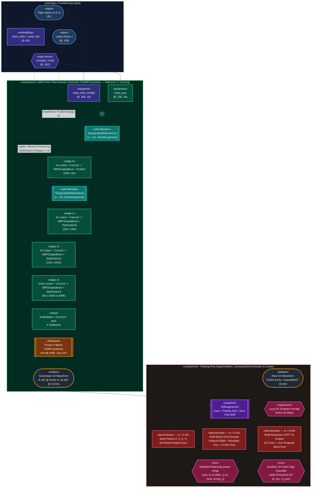

# AudioGAN — Multi-Band PQMF + Snake-Activation Conditional Audio GAN

A **pure time-domain generator** (zero-spectrogram inference) conditional GAN for generating spoken digits (`0–9`) on [FSDD](https://github.com/Jakobovski/free-spoken-digit-dataset) (8 kHz) or [AudioMNIST](https://github.com/soerenab/AudioMNIST) (16 kHz).

## Architecture Diagram



## Architecture Highlights

- **100% Time-Domain PQMF-Snake Generator** ([models.py](pqmf_snake_gan/models.py), [pqmf.py](pqmf_snake_gan/pqmf.py)):
  - Per-class learned temporal blueprints + lightweight 1D self-attention (`16 -> 64`) for multi-syllable word planning.
  - Linear upsampling + wider late channels + `SnakeBeta` periodic activations + silence-preserving multiplicative `StyleGate1d` at high rates.
  - Frozen 4-band cosine-modulated PQMF synthesis (>64 dB SNR) producing 8 kHz (`8,192` samples) or 16 kHz (`16,384` samples) waveforms directly.
- **Training-Only Multi-Resolution STFT + Multi-Band + Multi-Period Discriminator** ([models.py](pqmf_snake_gan/models.py)):
  - **Multi-Resolution STFT 2D Discriminator (MRD, weight 0.50)** with temporal-preserving word pooling and an **Auxiliary 10-class Digit Classifier** to enforce formants, fricatives, and phoneme order.
  - **Multi-Band Time-Domain Discriminator (MBD, weight 0.25)** on 4 PQMF subbands + rectified amplitude envelope.
  - **Multi-Period Discriminator (MPD, weight 0.25)** on periods `2, 3, 5, 7` for clean pitch harmonics.
- **Anti-Collapse Conditioning & Stability** ([train.py](pqmf_snake_gan/train.py)):
  - Single-pass **Matching-Aware Hinge Loss** (penalizing `(real, wrong_digit)`), **Auxiliary Digit Cross-Entropy**, un-attenuated Projection Conditioning, lazy **R1 gradient penalty**, zero-padded `DiffAugment1d` (with polarity flip), AMP, and EMA generator weights.

## Design Heritage & Building Blocks

Most papers using PQMF, `SnakeBeta`, MPD, and MRD are **neural vocoders** (paired Mel-spectrogram → waveform reconstruction). This project adapts those modern vocoder inductive biases into a **single-stage, direct `(noise z, class label) → raw waveform` GAN** (zero spectrograms at inference, no separate vocoder stage):

| Block / Technique                                           | Origin / Inspiration                                                                                                                                                                                                              | How It Is Used & Adapted Here                                                                                                                                                                                                            |
| ----------------------------------------------------------- | --------------------------------------------------------------------------------------------------------------------------------------------------------------------------------------------------------------------------------- | ---------------------------------------------------------------------------------------------------------------------------------------------------------------------------------------------------------------------------------------- |
| **1D Waveform GAN + `PhaseShuffle1d`**                      | [WaveGAN](https://arxiv.org/abs/1802.04208) (Donahue et al., 2019)                                                                                                                                                                | Core single-stage `(z, digit) → waveform` setting; `PhaseShuffle1d` prevents the 1D time-domain discriminators from exploiting exact sample-index alignment.                                                                             |
| **Frozen Cosine-Modulated PQMF Bank**                       | [Multi-Band MelGAN](https://arxiv.org/abs/2005.05106) (Yang et al., 2020), [RAVE](https://arxiv.org/abs/2111.05011) (Caillon & Esling, 2021), Creusere & Mitra (1995)                                                             | Generator predicts 4 subbands at `1/4` sample rate and synthesizes full-band audio with a frozen >64 dB SNR filterbank ([pqmf.py](pqmf_snake_gan/pqmf.py)), making synthesis ~4× faster without FFTs.                                    |
| **MRF Dilated Residual Blocks & MPD**                       | [HiFi-GAN](https://arxiv.org/abs/2010.05646) (Kong et al., 2020)                                                                                                                                                                  | Multi-receptive-field dilated Conv1d stacks (`dilations = 1, 3, 5`) model overlapping harmonic/phoneme scales; `MultiPeriodDiscriminator` (`periods = 2, 3, 5, 7`, weight `0.25`) enforces clean voiced pitch periodicity.               |
| **`SnakeBeta` & Multi-Resolution STFT Discriminator (MRD)** | [BigVGAN](https://arxiv.org/abs/2206.04658) (Lee et al., 2023), [Snake](https://arxiv.org/abs/2006.08195) (Ziyin et al., 2020), [UnivNet](https://arxiv.org/abs/2106.07889) (Jang et al., 2021)                                   | Tightly clamped `SnakeBeta` gives 1D convolutions a periodic inductive bias without excessive subband aliasing; training-only 3-scale `MRD` (weight `0.50`) exposes formants and fricatives while keeping inference 100% time-domain.    |
| **Zero-Init 1D Self-Attention (`gamma`)**                   | [SAGAN](https://arxiv.org/abs/1805.08318) (Zhang et al., 2019)                                                                                                                                                                    | `TemporalSelfAttention1d` at low temporal lengths (`16` and `64`) starts as identity and learns global cross-syllable coherence (e.g., _ze-ro_, _se-ven_) at negligible cost.                                                            |
| **Per-Class Temporal Blueprints & `StyleGate1d`**           | Custom adaptation for raw-audio cGANs                                                                                                                                                                                             | `class_time_emb[y]` supplies each digit with a learned temporal skeleton; `FiLM1d` is restricted to stage 0 (`L = 64`), while high-rate stages use multiplicative-only `StyleGate1d` (`0 * (1 + g) = 0`) so silence stays strictly zero. |
| **Projection + Matching-Aware + AC-GAN Losses**             | [Projection Discriminator](https://arxiv.org/abs/1802.05637) (Miyato & Koyama, 2018), [Matching-Aware GAN](https://arxiv.org/abs/1605.05396) (Reed et al., 2016), [AC-GAN](https://arxiv.org/abs/1610.09585) (Odena et al., 2017) | Temporal-preserving word pooling (`2×4` in MRD, `6`-slot in MBD) feeds un-attenuated class projection, single-pass `(real, wrong_digit)` rejection, and an auxiliary 10-class digit classifier to prevent class collapse.                |
| **DiffAugment & Lazy R1 Penalty**                           | [DiffAugment](https://arxiv.org/abs/2006.10738) (Zhao et al., 2020), [StyleGAN2](https://arxiv.org/abs/1912.04958) (Karras et al., 2020)                                                                                          | Time-domain gain jitter, polarity flip, and zero-padded shift + lazy R1 regularization (every 16 steps) prevent discriminator memorization on small datasets like FSDD (3,000 clips).                                                    |

## Quickstart

```bash
# 1. Verify PQMF SNR, 8 kHz & 16 kHz shapes, AC/matching-aware losses, and R1 gradients
python -m pqmf_snake_gan.train --smoke-test

# 2a. Train on FSDD (native 8 kHz, 3k clips; auto-adapts fsdd_16k.npz to 8 kHz / 8,192 samples)
python -m pqmf_snake_gan.train --data-dir data_cache/fsdd_16k.npz --out-dir runs/pqmf_fsdd_8k_v2 --sample-rate 8000 --epochs 350 --batch-size 32

# 2b. Or train on full AudioMNIST (30k clips @ 16 kHz / 16,384 samples)
python -m pqmf_snake_gan.train --data-dir audioMNIST --build-cache data_cache/audiomnist_16k.npz --out-dir runs/pqmf_audiomnist_16k --sample-rate 16000 --epochs 100 --batch-size 64

# 3. Generate spoken digits 0-9 using EMA weights
python -m pqmf_snake_gan.generate --checkpoint runs/pqmf_fsdd_8k_v2/checkpoint_latest.pt --digits 0 1 2 3 4 5 6 7 8 9
```

For interactive exploration and inline audio playback, open [PQMF_Snake_AudioGAN.ipynb](PQMF_Snake_AudioGAN.ipynb).
