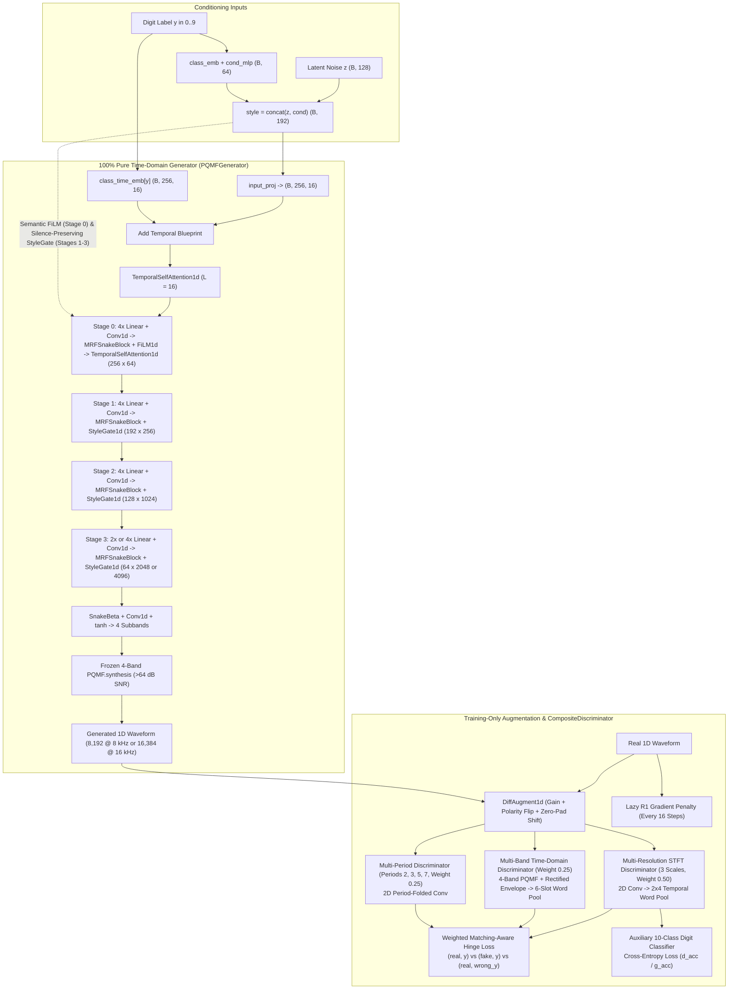

# AudioGAN — Multi-Band PQMF + Snake-Activation Conditional Audio GAN

A **pure time-domain generator** (zero-spectrogram inference) conditional GAN for generating spoken digits (`0–9`) on [FSDD](https://github.com/Jakobovski/free-spoken-digit-dataset) (8 kHz) or [AudioMNIST](https://github.com/soerenab/AudioMNIST) (16 kHz).

## Architecture Diagram



## Architecture Highlights
- **100% Time-Domain PQMF-Snake Generator** ([models.py](pqmf_snake_gan/models.py), [pqmf.py](pqmf_snake_gan/pqmf.py)):
  - Per-class learned temporal blueprints + lightweight 1D self-attention (`16 -> 64`) for multi-syllable word planning.
  - Linear upsampling + wider late channels + `SnakeBeta` periodic activations + silence-preserving multiplicative `StyleGate1d` at high rates.
  - Frozen 4-band cosine-modulated PQMF synthesis (>64 dB SNR) producing 8 kHz (`8,192` samples) or 16 kHz (`16,384` samples) waveforms directly.
- **Training-Only Multi-Resolution STFT + Multi-Band + Multi-Period Discriminator** ([models.py](pqmf_snake_gan/models.py)):
  - **Multi-Resolution STFT 2D Discriminator (MRD, weight 0.50)** with temporal-preserving word pooling and an **Auxiliary 10-class Digit Classifier** to enforce formants, fricatives, and phoneme order.
  - **Multi-Band Time-Domain Discriminator (MBD, weight 0.25)** on 4 PQMF subbands + rectified amplitude envelope.
  - **Multi-Period Discriminator (MPD, weight 0.25)** on periods `2, 3, 5, 7` for clean pitch harmonics.
- **Anti-Collapse Conditioning & Stability** ([train.py](pqmf_snake_gan/train.py)):
  - Single-pass **Matching-Aware Hinge Loss** (penalizing `(real, wrong_digit)`), **Auxiliary Digit Cross-Entropy**, un-attenuated Projection Conditioning, lazy **R1 gradient penalty**, zero-padded `DiffAugment1d` (with polarity flip), AMP, and EMA generator weights.

## Quickstart

```bash
# 1. Verify PQMF SNR, 8 kHz & 16 kHz shapes, AC/matching-aware losses, and R1 gradients
python -m pqmf_snake_gan.train --smoke-test

# 2a. Train on FSDD (native 8 kHz, 3k clips; auto-adapts fsdd_16k.npz to 8 kHz / 8,192 samples)
python -m pqmf_snake_gan.train --data-dir data_cache/fsdd_16k.npz --out-dir runs/pqmf_fsdd_8k_v2 --sample-rate 8000 --epochs 350 --batch-size 32

# 2b. Or train on full AudioMNIST (30k clips @ 16 kHz / 16,384 samples)
python -m pqmf_snake_gan.train --data-dir audioMNIST --build-cache data_cache/audiomnist_16k.npz --out-dir runs/pqmf_audiomnist_16k --sample-rate 16000 --epochs 100 --batch-size 64

# 3. Generate spoken digits 0-9 using EMA weights
python -m pqmf_snake_gan.generate --checkpoint runs/pqmf_fsdd_8k_v2/checkpoint_latest.pt --digits 0 1 2 3 4 5 6 7 8 9
```

For interactive exploration and inline audio playback, open [PQMF_Snake_AudioGAN.ipynb](PQMF_Snake_AudioGAN.ipynb).
